# Lotería Push — Notificaciones push (FCM) con un cantor de Lotería en la nube

Proyecto construido con **TDD (Rojo → Verde → Refactor)**: una Lotería mexicana donde el **cantor vive en un
servidor Node** y cada carta cantada llega como **notificación push** (Firebase Cloud Messaging) a la app
**Flutter** de todos los jugadores de la sala.

- **Materia:** Desarrollo Móvil Integral — UTNG
- **Profesor:** Anastacio Rodríguez García

> 🔔 Regla de oro: **el push es un AVISO, el servidor es la VERDAD.** La app sobrevive a mensajes perdidos,
> repetidos y desordenados porque siempre puede sincronizarse con el servidor.

---

## ¿Qué hace?

| Parte | Qué hace |
|---|---|
| 🎤 **Cantor (servidor)** | Crea salas, reparte tablas de 16 cartas, canta cartas al azar y comprueba quién gana. |
| 📣 **Push a la sala** | Cada carta cantada se envía a un **tema** (`sala_ABCDE`) y llega a todos los jugadores. |
| 😮 **"¡Casi!"** | Aviso personal (por **token**) a quien está a una carta de ganar. |
| 🎉 **¡Lotería!** | El servidor revisa la tabla (filas, columnas, diagonales, esquinas, centro) y avisa a todos. |
| 📱 **App** | Tu tabla con frijolitos, la última carta cantada y el modo cantor. |
| 🔄 **Sincronizar** | Al abrir la app o si se perdió un push, pregunta al servidor qué cartas van. |
| 🙋 **Permiso** | Se pide tras explicar para qué; sin permiso la app sigue funcionando. |
| 🔐 **Seguridad** | Claves de cantor y jugador, freno de abuso, tokens muertos se borran, la cuenta de servicio nunca va en la app. |

---

## Estructura del proyecto

```
loteria_push/
├─ server/                 el cantor (Node, sin dependencias para las pruebas)
│  ├─ baraja.js  lineas.js  mensajes.js  sala.js  enviador.js  servidor.js
│  ├─ package.json
│  └─ test/                baraja, lineas, mensajes, sala, servidor   (61 pruebas)
├─ app/                    la app Flutter
│  ├─ lib/
│  │  ├─ dominio/          evento, partida, lineas, api_juego, puerto_push,
│  │  │                    controlador, sesion, almacen, cartas
│  │  ├─ infra/            puerto_fcm, api_http, fondo, canales_android, almacen_prefs
│  │  ├─ presentacion/     vms, pantalla_inicio, pantalla_juego, pantalla_cantor
│  │  ├─ app.dart
│  │  └─ main.dart
│  ├─ test/
│  │  ├─ falsos.dart                (dobles de prueba)
│  │  ├─ evento_lineas_test.dart    (17 pruebas)
│  │  ├─ partida_test.dart          (10 pruebas)
│  │  ├─ controlador_test.dart      (22 pruebas)
│  │  └─ pantalla_test.dart         (3 pruebas de widgets)
│  └─ pubspec.yaml
├─ capturas/               evidencias del ciclo rojo / verde
├─ paso1_ROJO.ps1
└─ paso2_VERDE.ps1
```

**52 pruebas en Flutter + 61 pruebas en Node.**

---

## Cómo ejecutarlo

### 1. Servidor (no necesita Firebase)
```powershell
cd server
npm test        # 61 pruebas en verde
npm start       # el cantor en el puerto 8080, con push SIMULADO (se ve en la consola)
```

### 2. App: preparar el proyecto
En otra terminal, dentro de `app`:

```powershell
flutter create . --project-name loteria_push
Remove-Item test\widget_test.dart
flutter pub get
flutter test
```

`--project-name loteria_push` es importante porque la carpeta se llama `app` y el código usa `package:loteria_push`.
Las pruebas **no** necesitan Firebase.

### 3. Conectar Firebase (para correr la app)
1. Crea un proyecto en la consola de Firebase.
2. Instala las herramientas:
   ```powershell
   npm install -g firebase-tools
   firebase login
   dart pub global activate flutterfire_cli
   ```
3. Dentro de `app`:
   ```powershell
   flutterfire configure
   ```
   Esto genera `lib/firebase_options.dart`. **Sin ese archivo la app no compila** (pero `flutter test` sí corre).

### 4. Configurar Android
En `android/app/src/main/AndroidManifest.xml`, fuera de `<application>`:

```xml
<uses-permission android:name="android.permission.INTERNET"/>
<uses-permission android:name="android.permission.POST_NOTIFICATIONS"/>
```

Dentro de `<application>` (agrega el atributo y el `meta-data`):

```xml
<application
    android:usesCleartextTraffic="true"
    ...>
  <meta-data
      android:name="com.google.firebase.messaging.default_notification_channel_id"
      android:value="cartas" />
</application>
```

> `usesCleartextTraffic` es **solo para desarrollo** (servidor local por http).

### 5. Correr la app
Con el servidor encendido (`npm start`) y un emulador o celular Android:

```powershell
flutter run
```

La app busca al servidor en `http://10.0.2.2:8080` (la computadora vista desde el emulador).
En un celular real usa la IP de tu computadora:

```powershell
flutter run --dart-define=SERVIDOR=http://192.168.1.50:8080
```

> 🔐 El JSON de la **cuenta de servicio** de Firebase solo va en el servidor (variable
> `GOOGLE_APPLICATION_CREDENTIALS`). **Nunca** en la app ni en GitHub.

---

## Ciclo TDD — Evidencias

🔴 **ROJO:** se escribe la prueba primero; falla porque el código todavía no existe.
🟢 **VERDE:** se escribe el código mínimo para que la prueba pase.
🔵 **REFACTOR:** se ordena el código sin romper las pruebas.

### 1. Servidor en Node
**🔴 Rojo**

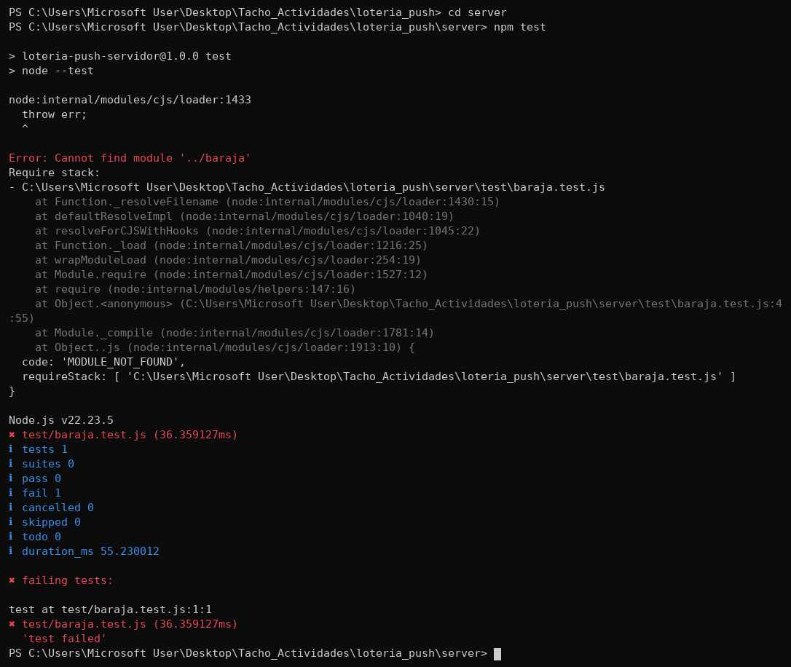

**🟢 Verde**

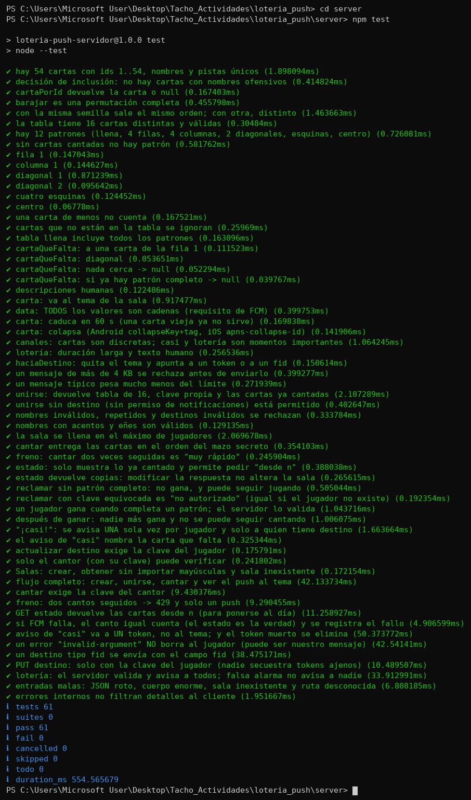

### 2. Eventos y líneas (app)
**🔴 Rojo**

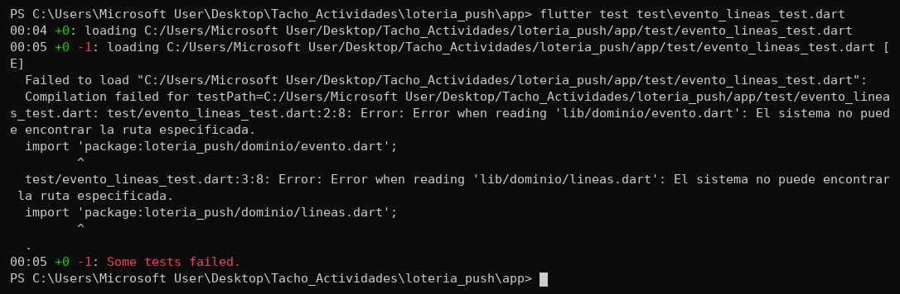

**🟢 Verde**

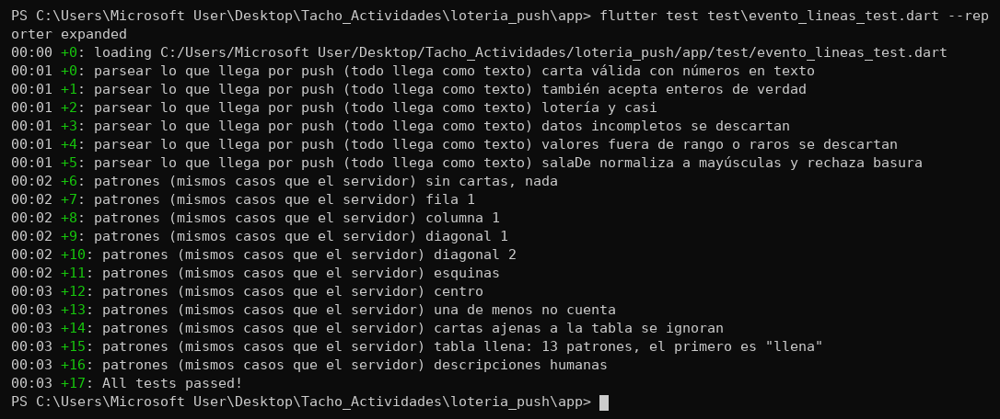

### 3. Partida
**🔴 Rojo**

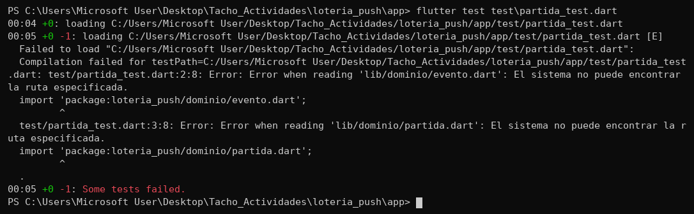

**🟢 Verde**

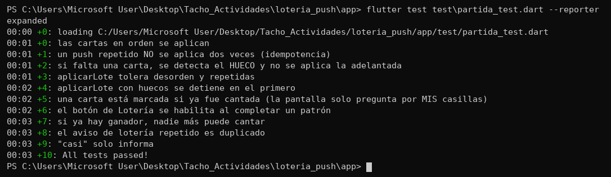

### 4. Controlador
**🔴 Rojo**

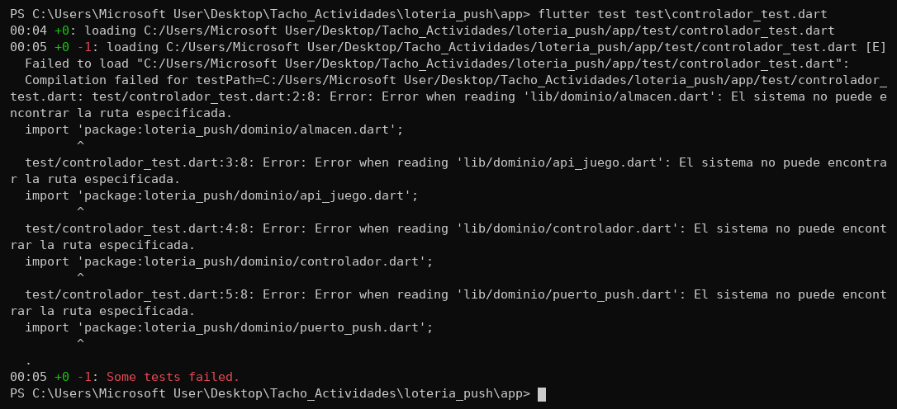

**🟢 Verde**

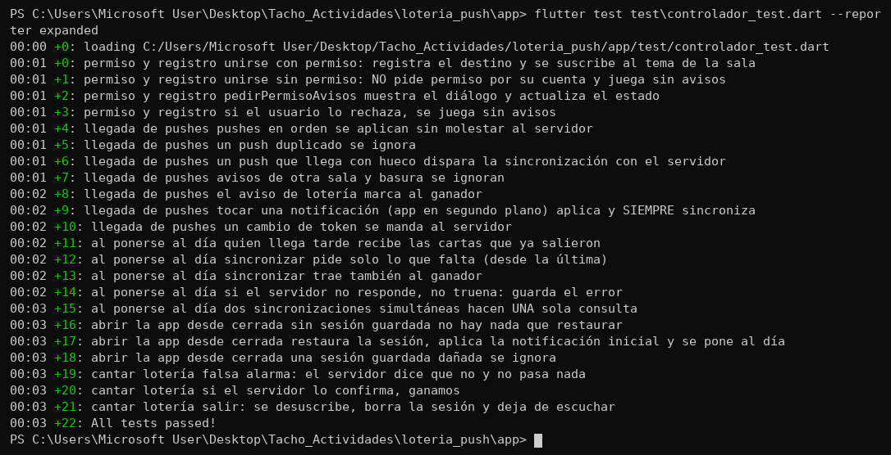

### 5. Pantalla (pruebas de widgets)
**🔴 Rojo**

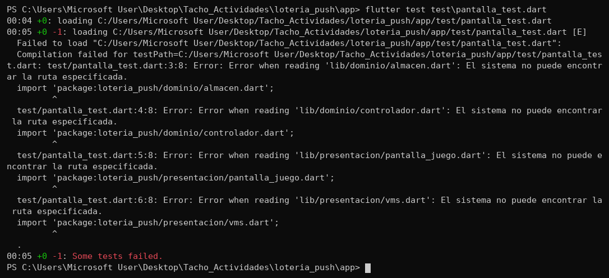

**🟢 Verde**

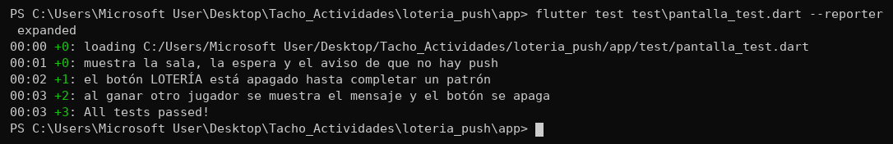

### 6. Todas las pruebas de Flutter
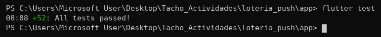

---

## Lista de verificación

- [x] `npm test` pasa (61 pruebas) y `flutter test` pasa en verde.
- [x] Los mensajes pasan una validación en seco (`FCM_DRY_RUN=1`) antes de enviarse de verdad.
- [x] Todos los valores de `data` son cadenas; ningún mensaje supera los 4 KB.
- [x] Cada tipo de mensaje tiene TTL, colapso y canal adecuados.
- [x] La app descarta mensajes de otra sala, incompletos o desconocidos sin tronar.
- [x] Un push repetido no se aplica dos veces y un push con hueco dispara la consulta al servidor.
- [x] Al abrir la app (cerrada, en segundo plano o al volver al frente) se sincroniza con el servidor.
- [x] El permiso se pide tras una explicación propia y la app funciona sin él.
- [x] El servidor decide quién gana y exige claves; el JSON de la cuenta de servicio no está en la app ni en el repositorio.
- [x] Los tokens muertos se borran; "invalid-argument" no borra a nadie.
- [x] Los canales de Android existen antes de la primera notificación.
